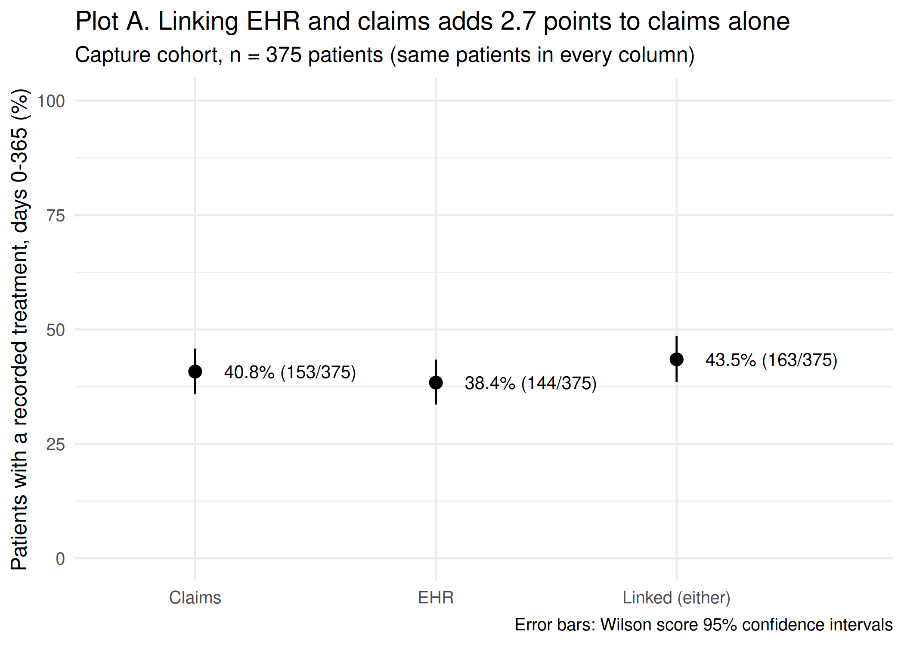
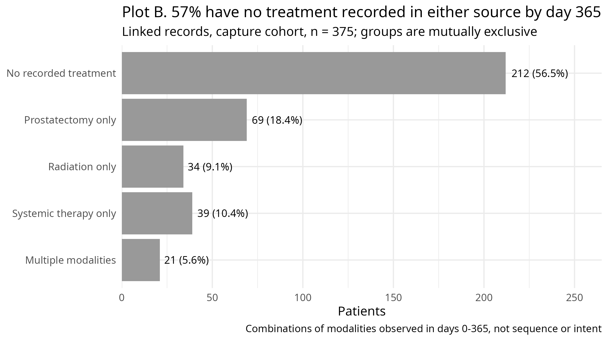
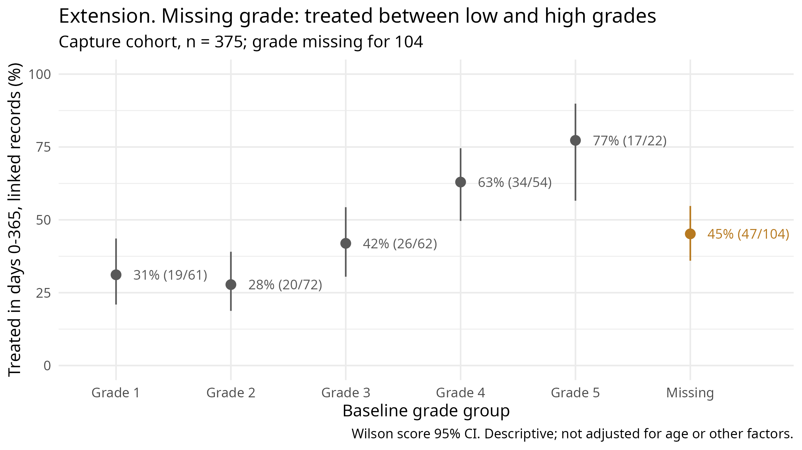

```{r setup, include = FALSE}
knitr::opts_chunk$set(echo = FALSE, message = FALSE, warning = FALSE)
library(readr); library(dplyr); library(knitr)
options(knitr.kable.NA = "")
o <- function(f) read_csv(here::here("output", "tables", f), show_col_types = FALSE)
flow <- o("table1_cohort_flow.csv"); cap <- o("table2_treatment_capture.csv")
mort <- o("table3_mortality.csv"); agree <- o("agreement_counts.csv")
dif <- o("linked_minus_claims.csv"); fit <- o("data_fitness.csv")
pat <- o("treatment_patterns.csv"); ext <- o("extension_missing_grade.csv")
s3 <- o("step3_exclusions.csv"); cd <- o("mortality_in_capture_cohort_for_comparison.csv"); eo <- o("ehr_only_detail.csv")
a <- setNames(agree$n, agree$group); pc <- setNames(pat$n, pat$pattern)
f1 <- function(x) formatC(x, format = "f", digits = 1)
ci <- function(l, u) paste0(f1(l), " to ", f1(u))
n_cap <- cap$n_patients[1]; n_base <- mort$denominator
```

**Plan (written before analysis, 2026-10-27).** Cohorts: Baseline, age 66 and above - EHR+claims data (crosswalk-joined) for 365 days lookback from index date, Capture: Baseline (nested) also observed through 365 days post index date using effective end. Treatment (Capture): code_map "treatment", days 0-365 both inclusive, describe statistics overall and for different modalities. Report claims/EHR/either linked proportions + Wilson's CI, treating groups as paired. Describe the agreement between either source. Mortality (Baseline): death by day 365, all-cause, Wilson's CI. Assess data reliability and log it. 

## 1. Cohorts

```{r}
kable(flow, col.names = c("Step", "Cohort", "Remaining", "Excluded"),
      caption = "Table 1. Cohort flow from the 800-patient roster.")
```

Mortality comes from the shared registry, so it needs only pre-index observation (baseline cohort, n = `r n_base`). Treatment can only be recorded while a source is observing, so the capture cohort additionally requires both sources' effective end (earliest of recorded end, death, 2023-12-31) on or after day 365. Of the `r flow$excluded[4]` patients removed at that step, `r s3$died_before_day365` died before day 365; the rest lost observation in at least one source.

## 2. Treatment capture

```{r}
kable(cap |> mutate(across(pct:ci_upper, f1)),
      col.names = c("View", "Treated", "Patients", "%", "95% CI low", "95% CI high"),
      caption = "Table 2. Treatment recorded on days 0-365, capture cohort. 95% CI: Wilson score.")
```



Claims recorded treatment for `r f1(cap$pct[1])`% and the EHR for `r f1(cap$pct[2])`%; linking raised this to `r f1(cap$pct[3])`%. Of `r n_cap` patients, `r a["Both sources"]` had treatment in both sources, `r a["Claims only"]` in claims only, `r a["EHR only"]` in the EHR only and `r a["Neither"]` in neither. The linked-minus-claims difference (`r f1(dif$pct)` points) is exactly the EHR-only share, so its Wilson interval (`r ci(dif$ci_lower, dif$ci_upper)`) is the interval for the gain from linkage.

The three figures describe the same patients, so they should not be read as independent groups. Claims-only records were surgery, radiation and injected ADT, consistent with care outside the EHR's health system. Of `r eo$n_ehr_only` EHR-only patients, `r eo$oral_adt_no_part_d` lacked Part D and had only oral ADT, which claims cannot see; `r eo$other` had surgery missing from claims despite Part D (unexplained; possibly a billing gap).

## 3. Initial treatment patterns



In linked records, `r pc["No recorded treatment"]` of `r n_cap` patients (`r f1(100 * pc["No recorded treatment"] / n_cap)`%) had no treatment recorded by day 365, plausibly reflecting active surveillance or watchful waiting in older men, though some treatment may be missing from both sources. Prostatectomy alone was the most common modality (`r pc["Prostatectomy only"]`), and `r pc["Multiple modalities"]` patients had two or more. These are combinations observed within the year, not sequence, switching or intent.

## 4. 365-day all-cause mortality

```{r}
kable(mort |> mutate(across(pct:ci_upper, f1)),
      col.names = c("Endpoint", "Cohort", "Denominator", "Deaths", "%", "95% CI low", "95% CI high"),
      caption = "Table 3. 365-day all-cause mortality from diagnosis (index date), baseline cohort. Deaths on days 0-365 inclusive; 95% CI: Wilson score.")
```

`r mort$deaths` of `r n_base` baseline patients died within 365 days (`r f1(mort$pct)`%). The capture cohort would be the wrong denominator: it excludes anyone whose death truncated observation before day 365, leaving only `r cd$deaths` deaths that fell exactly on day 365 (`r f1(cd$pct)`%). Mortality is not compared across treatment-pattern groups, since being treated requires surviving long enough (immortal-time bias).

## 5. Fitness for purpose

In the capture cohort, median baseline PSA among valid values was `r fit$median_psa_valid` ng/mL; PSA was missing for `r fit$psa_missing_n` (`r f1(fit$psa_missing_pct)`%) and grade group for `r fit$grade_missing_n` (`r f1(fit$grade_missing_pct)`%), including one invalid value (7) recoded as missing. Missing values were not imputed.

Treatment can be missed in three ways. **Care outside the EHR's health system** is invisible to the EHR; the `r a["Claims only"]` claims-only patients show this happens. **No Part D** (`r fit$part_d_0_n` capture patients) hides oral ADT from claims; injected ADT remains visible. **Care in neither extract** cannot be measured here, so the linked `r f1(cap$pct[3])`% likely underestimates the true proportion treated.

What we measured: agreement between sources, and which patients lack a recorded grade. We can only reason about treatment absent from both sources, and generalisation beyond fee-for-service Medicare men aged 66+. Eligibility rules also select patients: requiring 365 days of follow-up removed early deaths and patients who left either source. The Wilson intervals reflect sampling variation only; within this synthetic extract the proportions are exact, and the intervals do not account for systematic under-capture.

## 6. Extension: is a missing grade group random?

```{r}
ea <- filter(ext, part == "Grade missing, by age (baseline cohort)"); et <- filter(ext, part == "Treated, by grade (capture cohort)")
row <- function(d, g) d[d$group == g, ]
kable(ext |> mutate(across(pct:ci_upper, f1)),
      col.names = c("", "Group", "Patients", "Count", "%", "95% CI low", "95% CI high"),
      caption = "Table 4. Grade missing by age (baseline cohort) and treatment, linked days 0-365, by grade (capture cohort). 95% CI: Wilson score.")
```



**Question:** grade was missing for `r fit$grade_missing_n` capture patients (`r f1(fit$grade_missing_pct)`%). Are they treated like the least favourable grades? The brief defines no "low" or "high" cut-point, so grades are shown separately. Treatment rose with grade, from `r f1(row(et, "Grade 1")$pct)`% (grade 1) to `r f1(row(et, "Grade 5")$pct)`% (grade 5). Missing-grade patients were treated `r f1(row(et, "Missing")$pct)`% of the time (`r ci(row(et, "Missing")$ci_lower, row(et, "Missing")$ci_upper)`): between grades 1-2 and 4-5 (`r f1(row(et, "Grade 4")$pct)`% and `r f1(row(et, "Grade 5")$pct)`% for 4-5), closest to grade 3 (`r f1(row(et, "Grade 3")$pct)`%), with intervals overlapping grades 1-3. Dropping them, or assuming any single grade, could bias grade-based analyses.

Who is missing it is less clear. In the baseline cohort, missingness was highest in men 81+ (`r f1(row(ea, "81+")$pct)`%, `r ci(row(ea, "81+")$ci_lower, row(ea, "81+")$ci_upper)`), with overlapping intervals across age groups.

**Alternative readings:** older men may lack a gradable biopsy; the grade may sit in another provider's record; comparisons are unadjusted and some groups small.

**Limitation and next step:** I ran out of time to test robustness. Next I would run sensitivity analyses (each source alone, Part D patients only, age 80 or under vs 81+, a different-length window eg. 180 days) and adjust for age.

## Reproducibility

```{r}
sums <- read.table(here::here("data", "CHECKSUMS.sha256"), col.names = c("expected", "file"))
ok <- sapply(here::here("data", sums$file), digest::digest, algo = "sha256", file = TRUE) == sums$expected
kable(data.frame(Item = c("Raw files matching CHECKSUMS.sha256", "R version", "Rendered"),
                 Value = c(paste(sum(ok), "of", length(ok)), R.version.string, format(Sys.time(), "%Y-%m-%d %H:%M"))),
      caption = "Reproducibility record, generated at render time.")
```

```{r}
chk <- readLines(here::here("output", "logs", "automated_checks.txt"))
chk <- sub("^\\[PASS\\] ", "", chk[grepl("^\\[PASS\\]", chk)])
kable(data.frame(`Automated check (run on the real data)` = chk,
                 Result = "PASS", check.names = FALSE),
      caption = "Automated checks; code in R/03-tests.R. Any failure stops the pipeline.")
```

All results come from `Rscript run_all.R`; automated checks stop the pipeline on failure. Data issues: `output/logs/data_issues.csv`; every data check run: `output/logs/data_checks_summary.csv`.